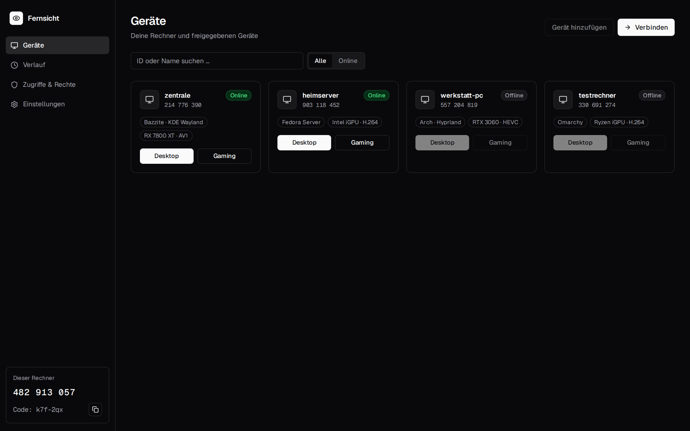
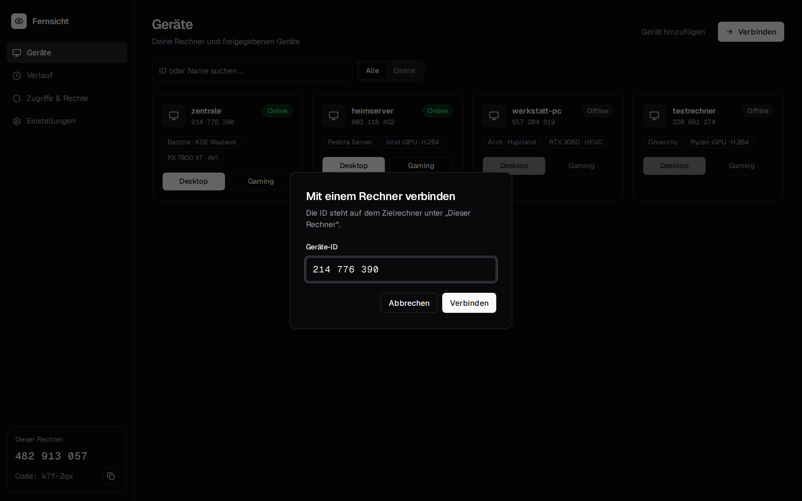
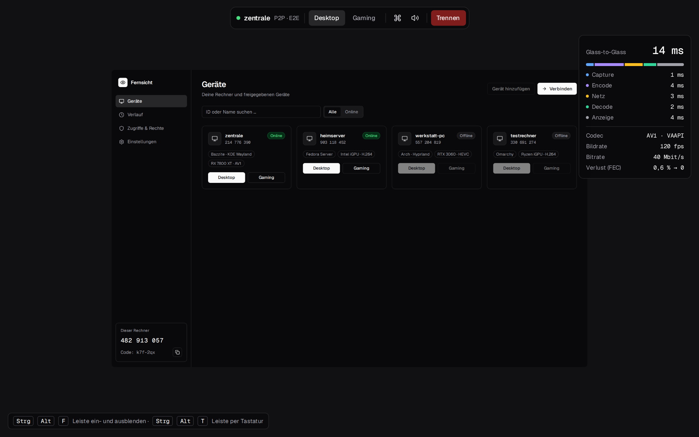
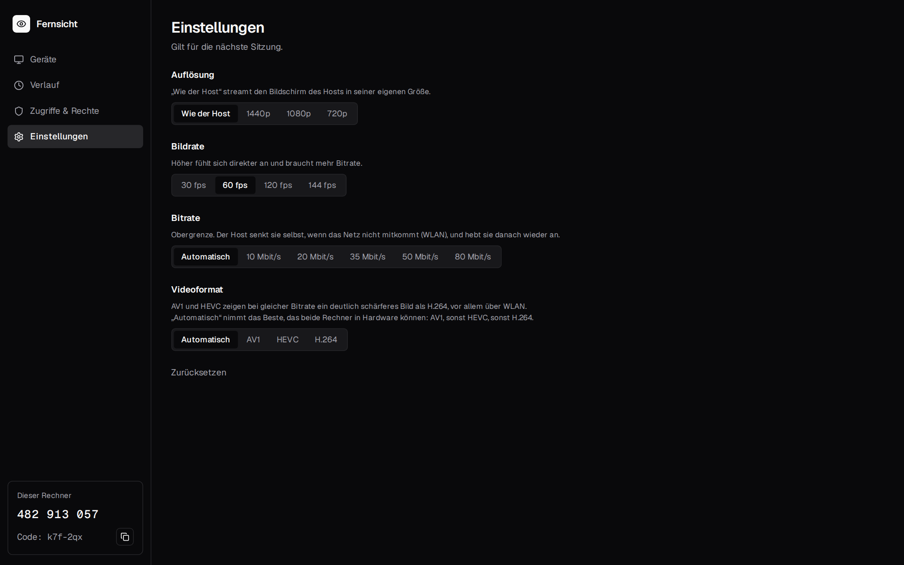

# The app

The Fernsicht app lists the computers in your network, pairs with them and starts sessions. The
picture opens in its own window (Vulkan); the app shows the session's controls and the latency
overlay next to it. The interface is in German for now; the labels below are given in German with
their meaning.

Install it as described in the [installation guide](installation.md). On a computer you also want
to control, the app sets up the host service as well (“Diesen Rechner freigeben”).

## Devices

“Geräte” (devices) shows every host the app found in the LAN and every host you paired with, paired
ones first:

- **Online / Offline**, the operating system, the GPU and its best codec, “Kopplung offen” (pairing
  open, a PIN is shown there now) and “In Benutzung” (in use by someone else).
- Search by name or address (“Name oder Adresse suchen …”), filter with “Alle” or “Online” (all,
  online).
- **Desktop** and **Gaming** start a session in that mode.
- “Gerät vergessen” (forget device) removes a paired host here; it has to be paired again.
- The list refreshes every 5 seconds. The computer's own host is not listed: it is “Dieser Rechner”
  (this computer) at the bottom of the sidebar.

Discovery is a broadcast on UDP 47800 and only reaches the local network. Hosts you paired with are
also asked directly at their last address, so they show up through a VPN too
([remote access](remote-access.md)).

In the app a session starts from the device's card. The UI in a plain browser (the demo) shows
devices of an account instead, which needs the rendezvous server that is not built yet
([next steps](next-steps.md)); there “Verbinden” (connect) opens a dialog for a device ID:

## Pairing

Once per pair of devices:

1. On the computer to control: “Dieser Rechner” → “Gerät koppeln” (pair a device). It shows a
   6-digit PIN for 5 minutes (“PIN für das neue Gerät”). On a host without the app:
   `fernsicht-host-agent pair`.
2. On the other computer: the host shows “Kopplung offen”; click “Koppeln” (pair) and enter the PIN.

From then on the two know each other's keys and every session is encrypted. Three wrong PINs close
the pairing. How it works: [security](security.md).

## Sharing this computer

Under “Dieser Rechner” (this computer):

- “Diesen Rechner freigeben” (share this computer) installs the host from the AppImage as the system
  service `fernsicht-host-agent` (KDE asks for your password).
- “Host aktualisieren auf …” (update the host to …) appears when the app carries a newer host than
  the installed one.
- “Freigabe beenden” (stop sharing) removes the service again.

## A session

The picture opens in its own window. While input goes to the host, the window keeps a few key
combinations for itself:

| Keys | |
|---|---|
| Ctrl+Alt+Shift+F | fullscreen on and off |
| Ctrl+Alt+Shift+M | capture the pointer, or let it go |
| Ctrl+Alt+Shift+← / → | the host's previous / next monitor |
| Ctrl+Alt+Shift+Q | end the session |

Watching only (`--view-only`): Esc closes, F11 toggles fullscreen, PageUp/PageDown switch monitors.

The app's session page has the toolbar:

- **Desktop / Gaming** switches the mode during the session.
- “Tasten senden” (send keys) sends Ctrl+Alt+Del, the Super key (KDE: Meta), Super+W, Alt+Tab, Alt+F4 or
  Print to the host.
- “Bildschirm wählen” (choose screen), with two or more monitors on the host: switch the monitor
  shown. The pointer follows.
- Sound on and off; “Trennen” (disconnect).
- The clipboard needs no button: it is shared by itself ([below](#clipboard)). Sending files is not
  built yet.

Every key goes to the host, so the toolbar has its own way in: Ctrl+Alt+F shows and hides it,
Ctrl+Alt+T moves the keyboard into it (Tab, arrows, Enter; menus open with the arrow keys), and Esc
gives the keyboard back to the host. A mouse click on the toolbar does not take the keyboard away
from the host.

### Latency overlay

The overlay shows glass-to-glass latency and its stages – Capture, Encode, “Netz” (network), Decode,
“Anzeige” (display) – with the spread (p95 and maximum) below it, plus the codec and what decodes it
on this computer (Vulkan Video, VAAPI or NVDEC: the app takes the first that works, in this order),
frame rate, bitrate, loss before and after FEC and the round trip (RTT). Glass-to-glass here is
measured up to the moment the picture is handed to the window; the monitor's own delay comes on top
([architecture](architecture.md#latency-measurement)). In the web viewer, decode and display come
from the frames the browser shows (from the last packet to the screen), and the loss row reads
packets lost → frames dropped, as WebRTC there has no FEC.

### Desktop and gaming mode

- **Desktop:** the pointer moves absolutely. The window shows the host's pointer image as its own
  pointer, so it moves at once, without the round trip; until the host knows where in the image the
  pointer's tip is (a moment after the first move), the host's pointer is drawn in the picture.
- **Gaming:** a click into the window captures the pointer; it then moves relatively, as games want
  it. Ctrl+Alt+Shift+M lets it go. Frames show the moment they are drawn instead of at the monitor's
  next refresh (up to one refresh less latency, ≈ 8 ms at 60 Hz), at the cost of occasional
  tearing, as in games without vsync; on Wayland where the desktop allows it (KDE: in full
  screen).

### System keys

The desktop the app runs on keeps keys such as Meta, Meta+W, Alt+Tab and Ctrl+Alt+Del for itself.
While the window has the focus **and** is fullscreen or holds the pointer, it asks the desktop to
pass them to the host instead (Wayland `keyboard-shortcuts-inhibit`; KDE asks once whether to allow
it; on X11 a keyboard grab). In a plain window Alt+Tab stays local, so you can always get out. When
the desktop refuses, the “Tasten senden” menu still works.

### Clipboard

Text copied on one side can be pasted on the other, both ways, up to 256 KiB. When a session starts,
this computer's clipboard goes to the host (it wins over what the host held). It takes a desktop
that offers Wayland's clipboard protocol for managers (data control): KDE Plasma, Sway, Hyprland,
COSMIC. GNOME does not offer it, and then there is no shared clipboard. Only sessions that may
control the host share it; a view-only session and the web viewer do not. `--no-clipboard` (client
and host) turns it off.

### Gamepads

Up to four controllers on the client become virtual Xbox 360 controllers on the host (“Fernsicht
X-Box 360 pad 1” …), which Steam and games use without setup. `--no-gamepad` leaves them out.
Like keyboard and mouse they follow the focus: while another window has it, the pads do nothing on
the host (buttons are let go, sticks centred).

The client reads them through SDL3, which the AppImage carries (a client built from source uses
the system's): SDL's controller database knows the layout of hundreds of pads, so A is the bottom
button on any of them. When a game on the host rumbles its pad, the client's pad rumbles too (SDL
only). Without SDL3 the client reads the pads from the kernel (evdev) as before, without rumble;
the log says which (“gamepads through SDL”).

A PlayStation pad (DualShock 4 or DualSense) becomes a DualSense on the host instead (“Fernsicht
DualSense pad 1”), with its motion sensors, touchpad and touchpad click, so games with gyro aiming
or touchpad controls get them; rumble works the same. That takes `/dev/uhid` on the host, which the
host service has; a host without it makes an Xbox pad as before (its log says so).

## Settings

“Einstellungen” (settings) apply to the next session:

| Setting | |
|---|---|
| “Auflösung” (resolution) | “Wie der Host” (as the host: its screen's own size), 1440p, 1080p, 720p |
| “Bildrate” (frame rate) | 30, 60, 120, 144 fps |
| “Bitrate” | “Automatisch” (chosen by the host for the size: about 20 Mbit/s for 1080p60, 36 for 1440p60) or 10–80 Mbit/s. An upper bound: the host lowers it by itself on congestion |
| “Videoformat” (video format) | “Automatisch” (the best both computers do in hardware: AV1, then HEVC, then H.264), AV1, HEVC, H.264 ([codecs](video.md#codecs)) |
| “Nach Verlusten” (after losses) | “Scharf” (sharp: the host sends a keyframe, the picture waits one round trip and is sharp again) or “Flüssig” (smooth: the picture goes on and mends itself within half a second; NVIDIA hosts only, others stay sharp) ([intra refresh](video.md#conversion-and-encoding)) |

With a host on this computer there is one more section, “Dieser Rechner als Host” (this computer as
host): “Grafikkarte während Sitzungen hochtakten” (raise the GPU's clocks during sessions). Between
two frames a GPU clocks down and the next frame takes longer to encode; while a session runs the
host keeps it at full clocks and restores everything afterwards (AMD and Intel). Below it, “Gekoppelte Geräte” (paired devices) lists the devices that may connect to this
computer; “Entfernen” (remove) forgets one, ends its session if it has one, and it has to be
paired again. “Verbindung über das Internet” (connecting over the internet) takes the address of
the host's own rendezvous service, so that paired devices reach this computer from anywhere
([over the internet](internet.md#everyone-runs-their-own)); below it the host says how it stands
with it: off, connecting, reachable (with or without a relay), or why not. “Portfreigabe beim
Router anfragen” (ask the router to forward the port) has the host ask its router by UPnP, NAT-PMP
or PCP; the line below it says what the router forwards, or why it does not. Devices learn the
address in their next session with this computer. In a session over the internet the toolbar
shows “Relay” instead of “P2P” when it runs through a relay.
