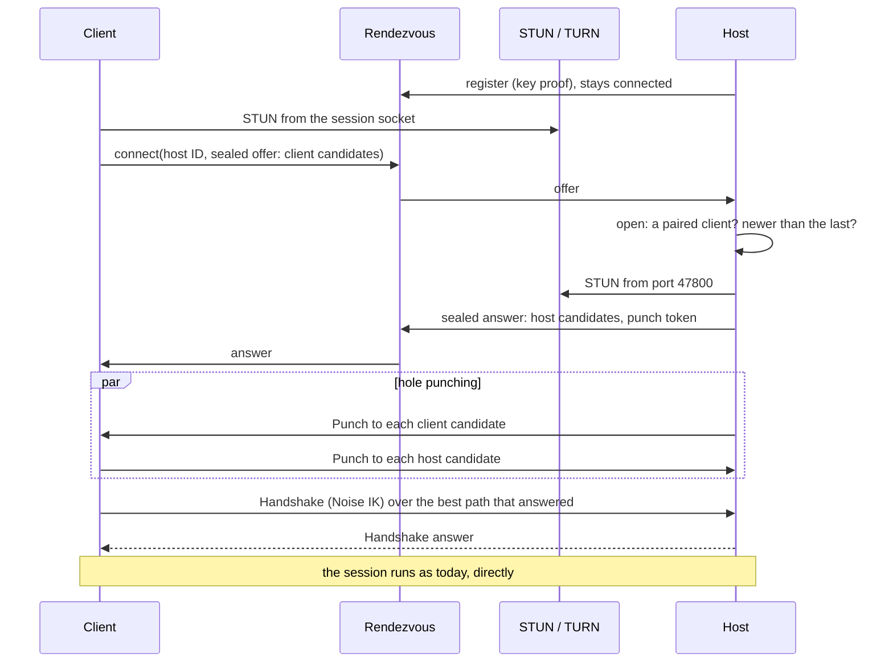

# Over the internet

!!! note "Status: built, not yet seen live"
    The rendezvous service (a Cloudflare Worker and a Rust service), hole punching over IPv4 and
    IPv6 and the TURN relay are built and tested on one machine (host, client, service, STUN and a
    real coturn; the Worker in `wrangler dev`). Port forwarding by the router and the web viewer
    over the internet are the [stages](#stages) still to come. Nobody has connected two real homes
    with it yet ([handover](handover.md#what-nobody-has-seen-live-yet)).

This page is how Fernsicht connects two devices anywhere, without a VPN and without setting up
the router, the way remote desktop tools do.

## The goal

Pair once (in the LAN, or by typing the PIN shown on the host), then connect from anywhere: from a
friend's Wi-Fi, a phone's hotspot, a hotel. The picture should travel **directly** between the two
devices wherever the networks allow it, with the same latency as any other path through the
internet, and through a relay only where they do not.

What stays as it is:

- **The protocol and the session.** Same UDP port, same packets, same Noise IK handshake, FEC,
  pacing and bitrate adaptation. Only the way the first packet finds the other device is new.
- **Security.** Only paired devices get in; everything is end-to-end encrypted. Nothing on the way
  (rendezvous, relay) can read or forge a packet ([security](#security)).
- **No account.** The device keys from pairing are the identity; nobody signs in anywhere.

What is not a goal: connecting to a host nobody paired with (no TeamViewer-style ID plus password),
or a server that sees the picture.

## How remote desktop tools do it

Most home and mobile networks sit behind NAT: the router lets answers in, but nothing that starts
outside. Remote desktop tools (TeamViewer, Parsec, Moonlight with Sunshine's helpers, Tailscale, the
ICE part of WebRTC) all combine the same pieces:

1. **A rendezvous service** both sides can reach, because a connection that starts from inside always
   gets out. Through it they tell each other where they are.
2. **STUN** (RFC 8489): a device asks a server on the internet which public address and port its
   packets come from.
3. **Hole punching:** both send UDP packets to each other's public address at the same time. Each
   router has then seen a packet go out to the other side and lets the answer in. This works for
   most home routers and many mobile networks, and the picture then travels directly.
4. **A relay (TURN**, RFC 8656) for the rest: networks whose NAT gives every destination its own
   port (symmetric NAT, some carrier-grade NAT and company firewalls) cannot be punched through; the
   packets then go through a server.

Two more ways need no server at all and come first: **IPv6**, where every device has a public
address and the router's firewall only has to be punched like a NAT, and **asking the router to
forward the port** (UPnP IGD, NAT-PMP, PCP), as Sunshine does.

## The ladder

The client tries every way it knows **at once** and keeps the best one that answers. In order of
preference:

| # | Path | Needs | Extra latency |
|---|---|---|---|
| 1 | **LAN address** (discovery or the last address that worked) | same network or a VPN | none |
| 2 | **IPv6, direct** (punched through both firewalls) | IPv6 on both sides | none |
| 3 | **Port forwarded by the host's router** (UPnP IGD, NAT-PMP or PCP) | the router allows it, the host opted in | none |
| 4 | **IPv4, hole punched** | a NAT that keeps one port per socket on at least one side | none |
| 5 | **Relay (TURN)** | a TURN server | a few ms to tens of ms |

Paths 1 to 4 are direct: the packets take the internet's own route. Path 1 is today's behaviour.
Paths 2 to 5 need the rendezvous service to exchange addresses. Path 3 alone also works without it,
with a fixed address or a DynDNS name (as port forwarding by hand does today).

Many German connections have no public IPv4 address any more (DS-Lite on cable, some fibre and
mobile networks) but do have IPv6. Path 2 is therefore not a detail: for them it is the direct path.

### Candidates

Following ICE (RFC 8445), each side collects **candidates**, addresses it may be reached at:

- **host:** its own addresses on each interface (LAN IPv4, global IPv6), port 47800 on the host;
- **server-reflexive:** its public IPv4 address and port as STUN reports them;
- **mapped:** the address and port the router forwards (path 3, host only);
- **relayed:** an address on a TURN server (path 5).

All of them use **the session's own socket** (port 47800 on the host, the client's session socket):
a NAT maps one socket to one public port, so STUN must be asked from the socket that will carry the
stream. STUN, TURN and Fernsicht packets are told apart by their first byte, as RFC 7983 does for
WebRTC: 0–3 is STUN, 64–79 TURN's ChannelData, `0xF5` ours.

Candidates are gathered **when a connection is made**, not kept fresh in the background: a NAT
forgets an idle mapping within 30 s to a few minutes, so an address learnt earlier may be stale.

### Connecting



1. **Offer.** The client gathers its candidates and sends them through the rendezvous, sealed for
   the host ([signaling](#signaling-messages)).
2. **Check.** The host opens the offer. An offer from a device it is not paired with, or not newer
   than the last one, is dropped: the host gathers nothing, sends nothing and gives away nothing
   about where it is.
3. **Answer.** The host gathers its own candidates and answers, sealed for the client, with a random
   **punch token**.
4. **Punching.** For 5 s, every 100 ms in the first second and every 500 ms after (18 rounds at
   most), both sides send a small
   **Punch** packet (a new packet kind carrying the punch token) to each of the other's candidates.
   Each side's punches open its own NAT or firewall for the other; a side that receives a Punch with
   the right token answers it over the same path with a Punch of the same size. A Punch carries
   nothing else, a wrong token gets no answer, and the host punches only towards a paired client's
   candidates (at most 8), so nobody can point it at a stranger.
5. **Choosing.** The client takes the most preferred path (the ladder above) that answered within
   150 ms of the first answer, and starts the session there with its Handshake, as today. This is
   ICE's split into checking paths and then nominating one: the handshake goes over one path only,
   so its replay check (a handshake not newer than the last one is refused) stays as it is. The
   relay is only tried after 1.5 s without a direct answer ([the relay](#the-relay)), so it is never
   chosen where a direct path would have worked a moment later.
6. **The session** then runs as today, on the socket the probes went out on (the NAT's mapping
   belongs to it). An address found over the internet is a NAT's for this connection only: the
   client does not keep it as the host's address.

Before all this the client asks the host's last address directly (a discovery question, 0.4 s):
at home or over a VPN the host answers, and the session starts there as before, without the
service.

A running session keeps its NAT mappings open on its own (video one way, feedback the other). If a
path breaks during a session (the phone moves from Wi-Fi to mobile data), the client reconnects
through the rendezvous, which is the same as today's reconnect after 5 s of silence.

## The rendezvous service

A small service that only passes sealed messages between a host and its paired clients. It never
sees a picture, an input or a key that matters.

### Identity

- A host registers under its **rendezvous ID**: `SHA-256("fernsicht rendezvous v1" ‖ public key)`
  in hex (SHA-256, so that the Worker computes it with Web Crypto).
  A client knows the host's public key from pairing, so it can compute the ID, and nobody has to
  remember a number.
- **The host proves it holds the key** when it registers, using the X25519 key it already has (no
  second key pair): the service sends a fresh ephemeral X25519 public key and a nonce; the host
  answers with `HMAC-SHA256(DH(host secret, ephemeral), "fernsicht rendezvous proof v1" ‖ nonce ‖
  host key)`; the service computes the same from
  `DH(ephemeral secret, host public key)`. Only the holder of the host's key can register under its
  ID, so nobody can take over a host's place or squat on its ID.
- A **client does not register.** It does not need to be reachable; it only asks.

### Signaling messages

The host keeps a WebSocket open at `/v1/host/<ID>` (and pings it every 30 s). A client opens one
at `/v1/connect/<ID>` per connection, sends its offer and waits for the answer (at most 10 s). The
messages are JSON (`crates/internet/src/signal.rs`):

| Message | From → to | Content |
|---|---|---|
| `register` | host → service | its public key (the path names the ID) |
| `challenge` / `proof` | service ↔ host | the key proof above |
| `registered` | service → host | whether the service hands out relay credentials |
| `connect` | client → service | a sealed **offer** |
| `offer` | service → host | the sealed offer, a connection number, fresh TURN credentials |
| `answer` / `refuse` | host → service | the sealed **answer** for a connection, or no answer |
| `answer` / `error` | service → client | the answer, or why not (`offline`, `timeout`, `refused`, `rateLimited`, …) |

The **offer and the answer** are the two messages of a Noise IK handshake (the same pattern as the
session's, with the prologue `fernsicht rendezvous v1`), so that:

- the host learns which paired device is asking before it does anything, and the service does not
  (the client's key travels encrypted in the first message, as in every IK handshake);
- the candidates, the punch token and the TURN credentials are encrypted for the other device only;
- a recorded offer cannot be replayed: it carries the client's wall clock time, checked like the
  session handshake's.

The message types are Rust structs with serde, and the TypeScript the Cloudflare Worker uses is
generated from them with ts-rs, like the app's bindings.

### Two implementations

The decision from the [next steps](next-steps.md#open-decisions) is **both**:

- **A Cloudflare Worker with a Durable Object** (`web/rendezvous-worker`, TypeScript). One
  Durable Object per rendezvous ID holds the host's WebSocket (with the hibernation API, so an idle
  host costs no running time) and passes offers and answers. It fits Cloudflare's free plan by a
  wide margin: a connection is a handful of requests and a few kilobytes, against 100,000 requests
  and 13,000 GB-s of running time a day. No server to keep up to date, and close to everyone.
  Anyone can deploy it to their own Cloudflare account with `wrangler deploy`; no domain is needed
  (a `workers.dev` name works).
- **A small Rust service** (`apps/rendezvous`, one binary) with the same protocol, for whoever
  rather runs everything themselves: on a small VPS, next to coturn.

### Everyone runs their own

The project runs **no public rendezvous service**: whoever wants to connect over the internet
deploys their own, once, for all their devices. Nobody but that user (and Cloudflare, or their own
VPS) sees when their devices connect and from where, nobody's relay traffic is paid by someone
else, and an outage concerns only one user. The protocol is the same either way, so a public
service can still come later.

Setting it up with Cloudflare takes a few minutes:

1. **A Cloudflare account** (free; no own domain needed).
2. **Deploy the Worker**, either with the button

    [](https://deploy.workers.cloudflare.com/?url=https://github.com/firsttris/fernsicht/tree/main/web/rendezvous-worker)

    (it copies `web/rendezvous-worker` to one's GitHub account and deploys the Worker with its
    Durable Object; the folder stands on its own, its configuration is its `wrangler.jsonc`), or by
    hand:

    ```sh
    git clone https://github.com/firsttris/fernsicht
    cd fernsicht/web/rendezvous-worker
    npx wrangler@4 login
    npx wrangler@4 deploy
    ```

    Either way the Worker gets an address like `https://fernsicht-rendezvous.<name>.workers.dev`.
3. **Optionally the relay:** create a TURN key in the Cloudflare dashboard (Realtime → TURN) and
   give it to the Worker as secrets (`npx wrangler@4 secret put TURN_KEY_ID`, then
   `TURN_API_TOKEN`).
   Without them everything works except the relay: networks that allow no direct path cannot
   connect.
4. **Enter the address on the host**, in the app (“Dieser Rechner” → “Verbindung über das
   Internet”) or with `fernsicht-host-agent --rendezvous <url>`. The host registers there and the
   app shows whether that worked (“Erreichbar über das Internet”) and whether the Worker can hand
   out relay credentials.

With the Rust service, step 2 is running `fernsicht-rendezvous --listen 127.0.0.1:8080` on a VPS
behind a reverse proxy for HTTPS (Caddy, nginx), and step 3 coturn with `use-auth-secret`: the
service gets its URLs and secret (`--turn-url turn:turn.example.org:3478?transport=udp` and
`FERNSICHT_TURN_SECRET`) and hands out credentials coturn checks.

### The clients learn the address from the host

The address belongs to the host and is entered only there. **Clients learn it from the host in
every session:** once the session is confirmed, the host sends it in a sealed `Rendezvous` packet
([protocol](protocol.md)), so a client that paired before the address was set, or before it
changed, picks it up the next time it connects. Pairing itself stays as it is (devices of
different versions still pair); a device paired at home learns the address in its first session
there.

A client stores it with the paired host and uses it whenever the host does not answer at its
last address. A laptop or phone used once at home therefore connects from anywhere without being
set up; only the host was. `fernsicht-client --rendezvous <url>` names one by hand. Since the address arrives inside a sealed message from the host, nobody else can
point a client at a different service (and a different service could do no more than drop
messages anyway).

### Limits

The service keeps everything small and bounded: messages of at most 16 KiB, at most 10 connects per
minute per rendezvous ID and per client address, an offer waits at most 10 s, a host whose proof
fails is disconnected. The host itself handles at most a few offers a second; opening one is a
Noise operation and costs microseconds.

## The relay

Where no direct path works, the stream goes through a TURN server. TURN relays any UDP payload, so
the native protocol passes unchanged, inside ChannelData (4 bytes more per datagram).

- **The client allocates** the relay address, after 1.5 s without a direct answer: the client is
  the one in a hostile network (a hotel, a company, a mobile network), and the host is in a home
  network. It tells the host the relayed address with a second offer, binds a channel to each of
  the host's candidates, and probes through the relay; the host probes back to the relayed
  address. TURN permissions are by IP
  address only, not by port (RFC 8656, section 9), so the host reaches the relay even through a NAT
  that gives every destination its own port. One allocation is enough in nearly every case.
- **In the client** a thread sits between the session's socket and the TURN server: it wraps what
  the session sends in ChannelData, unwraps what comes back, and refreshes the allocation and the
  channel. The network thread stays as it is; the relay costs a hop through the kernel's loopback.
  `fernsicht-client --relay-only` goes through the relay at once, to check it.
- **Credentials** are short-lived (a few hours), handed out by the rendezvous service, never built
  into the app:
    - with Cloudflare's TURN service, the Worker keeps the API token as a secret and asks Cloudflare
      for credentials;
    - with coturn, the Rust service mints them with coturn's shared secret (the TURN REST API
      scheme: an expiry time as user name, an HMAC of it as password).

  The service gives credentials only to a registered host (it proved its key), which passes them
  on only to a paired client, inside the sealed answer. A stranger therefore cannot spend the
  relay's traffic.
- **Datagrams over the relay** are at most 1,200 bytes: the path through the relay is not known,
  so its MTU cannot be asked as for a direct route.
- **Bitrate:** a relayed session has its own upper limit (by default 15 Mbit/s, adjustable), since
  relay traffic may cost money. The bitrate adaptation works as on any path; NACK is off anyway
  (the round trip is longer than a frame).
- **Cost:** Cloudflare's TURN service includes 1,000 GB a month for free, then $0.05 per GB. A
  session at 15 Mbit/s moves about 7 GB an hour, so the free amount covers well over 100 hours of
  relayed sessions a month. A VPS with coturn usually includes several terabytes.
- **The app says so:** the session's toolbar shows “P2P” or “Relay”.

## Port forwarding by the router

As an option (“Aus dem Internet erreichbar”, off by default), the host asks its router to forward
UDP 47800, first with PCP (RFC 6887), then NAT-PMP (RFC 6886), then UPnP IGD. PCP can also open
the IPv6 firewall for the port. The mapping is requested with a lifetime and renewed before it runs
out, and removed when the host stops or the option is turned off. A FritzBox does this when
“Selbstständige Portfreigaben für dieses Gerät erlauben” is ticked for the host.

A host reachable from the internet must behave differently towards strangers: it answers **Discover
only from local addresses** (private IPv4 ranges, IPv6 link-local and unique local, the host's own
subnets), so its name, GPU and status are not told to the internet. Pairing stays as it is (a
guess costs a full exchange and attempts are limited per address and in total).

## The web viewer

The browser has all of this built in (ICE in WebRTC); what is missing is on the host's side, and it
comes last:

- **HTTPS** for the page and the PIN: through a Cloudflare Tunnel to the host's web server, which
  carries the page and the WebRTC offer and answer (plain HTTP, no UDP needed), optionally behind
  Cloudflare Access.
- **The host's candidates** in its WebRTC answer: its server-reflexive address from STUN and its
  global IPv6 addresses, as well as the LAN address. str0m does no I/O of its own, so the host asks
  STUN itself and adds the candidate.
- **ICE servers for the browser:** STUN and short-lived TURN credentials, handed to the page with
  the answer, so the browser relays where needed.
- The check against DNS rebinding accepts the tunnel's public name once it is configured.

## Security

What the rendezvous service sees: hosts' public keys and rendezvous IDs, the IP addresses of hosts
and of clients that ask, and when they connect. It does not see names, which client is asking (its
key is encrypted), the candidates, or anything of a session. A relay sees encrypted packets and
their sizes, as any router on the way does.

| Threat | What prevents it |
|---|---|
| Someone registers in a host's name | the key proof: only the holder of the host's key can register its ID |
| A malicious or compromised rendezvous service | it can only drop or delay messages: offers and answers are Noise messages between the two devices; the worst it can do is deny service |
| Learning where a host is by asking for it | the host answers only paired clients; others learn nothing beyond whether the ID is registered |
| Replaying a recorded offer | the client's wall clock in the offer, checked like the session handshake's |
| Using the host to send packets at a victim | the host punches only towards candidates from a paired client's sealed offer, and only a few dozen small packets |
| Spending the relay's traffic | credentials only through a registered host, only to paired clients, short-lived, and a bitrate limit on relayed sessions |
| Strangers reaching a host with a forwarded port | as in the LAN: only paired devices get a session; Discover is answered only locally |

## Testing

- **Unit and property tests:** the STUN and TURN message parsers (never panic, never allocate, like
  `proto`), telling packets apart by their first byte, choosing a path from a set of answers,
  the key proof, the signaling messages.
- **End-to-end tests with real NATs:** network namespaces with nftables masquerading between them
  (the e2e tests already build impaired networks), one per kind of NAT: one port for all
  destinations, one per destination (symmetric), IPv6 with a stateful firewall. A local STUN and
  TURN server (coturn) and the Rust rendezvous service run beside them. Each test asserts which path
  was chosen: direct where the NATs allow it, relayed where they do not.
- **The Worker** against the same tests through `wrangler dev`.
- **Live:** a host at home, a laptop on a phone's hotspot (carrier-grade NAT), on IPv6 only, and in
  a network that blocks UDP except to the relay.

## Stages

1. **This design.** Done.
2. **Rendezvous, STUN and hole punching**, with IPv6 candidates: the Rust service and the Worker,
   the host's registration, the client's connect, the Punch packet, choosing a path, the address
   handed to clients in every session. Done.
3. **The relay:** a TURN client in the client (allocation, channels, ChannelData), credentials
   from the service, the relay's bitrate limit, “Relay” in the app. Done.
4. **Port forwarding by the router** (PCP, NAT-PMP, UPnP IGD) as an option, with Discover answered
   only locally.
5. **The web viewer over the internet:** HTTPS through a tunnel, the host's candidates, ICE servers.

## Open questions

- **A public rendezvous service later**, for users who do not want to set one up? Not now
  ([everyone runs their own](#everyone-runs-their-own)); if it comes, it would hand out no relay
  credentials, or only with a tight limit.
- **Pairing over the internet:** today pairing needs the host's address. With the rendezvous, a
  client could pair with a host it cannot see in the LAN using a short code that carries the
  rendezvous ID and the PIN. Worth it, or is pairing in the LAN once enough?
- **TURN over TCP or TLS on port 443** for networks that block UDP altogether (some company and
  hotel networks). It gets through nearly everywhere, but a lost packet then holds up all after
  it, which costs latency that FEC cannot repair. Worth offering as a last rung, marked as such?
